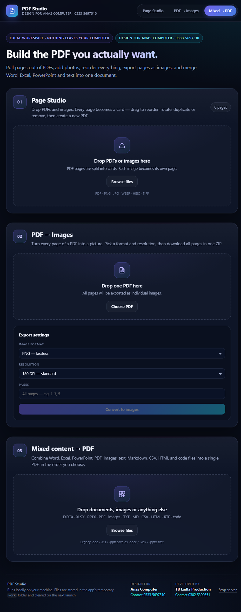

# PDF Studio

**Design for Anas Computer** · Contact **0333 5697510**  
**Developed by TB Ladla Production** · Contact **0302 5300651**

A local Windows app for putting together PDFs. Everything runs on your own machine — no uploads, no internet, no accounts.



## Download (Windows, no Python needed)

Get the latest ready-to-run build from the [Releases page](https://github.com/maliksabahat/pdf-studio/releases/latest):

- **`PDF-Studio-v2.0-Windows.zip`** — standalone app (about 56 MB).

To use it on any Windows PC:

1. Download the ZIP, copy it to that PC, and extract it completely. Do not run the EXE from inside the ZIP.
2. Open the extracted `PDF Studio` folder and double-click **`PDF Studio.exe`**.
3. The app starts and your browser opens automatically. If it does not, the black window shows the address (for example `http://127.0.0.1:54321`) — type it into your browser.
4. Keep the black window open while you work. To quit, click **Stop server** at the bottom of the page or close the black window.

Python is **not** required on that PC. Microsoft Word, Excel and PowerPoint are **not** required either.

> The first launch may show a blue **“Windows protected your PC”** message because the app is new and not code-signed. Click **More info → Run anyway**. This is normal for a locally built application.

## Run from source (Python)

1. Install the dependencies once:
   ```bat
   python -m pip install -r requirements.txt
   ```
2. Double-click **`run.bat`**, or run:
   ```bat
   python app.py
   ```

Python 3.10 or newer is required. `waitress` is optional but recommended; without it the app falls back to Flask's built-in server.

## Build the EXE again

Double-click **`build_exe.bat`**. It installs PyInstaller if needed, bundles the app and static files, copies `READ ME.txt`, and creates a fresh ZIP in `dist\`.

The build uses:

```bat
python -m PyInstaller --noconfirm --clean --console ^
  --name "PDF Studio" --icon "app.ico" ^
  --add-data "static;static" ^
  --collect-all pymupdf --collect-all pillow_heif ^
  --hidden-import waitress app.py
```

## The three sections

### 1. Page Studio
Drop in PDFs and images. Every PDF page and every image becomes a card.

- Drag cards to reorder, or use the arrow buttons for precise moves.
- Click any page thumbnail (or the expand button) to view it full size. Use ← / → to move between pages and + / − to zoom.
- Rotate, duplicate or delete individual cards.
- Set image page size (A4, Letter, A5, auto), fit (contain / cover), margin, and optionally force one uniform page size for the whole document.
- Name the file and click **Create PDF**. The download starts automatically.

PDFs with rotated pages are straightened automatically, and landscape pages keep their orientation.

### 2. PDF → Images
Drop one PDF, choose JPG, PNG or WebP, pick a resolution (72 / 150 / 300 DPI), quality, and an optional page range like `1-3,7`.

Every page is shown as a preview. Click a page to view it full size, or use its download icon to save just that page in the selected format.

Click **Convert to images** to get one ZIP containing every page as a picture. If the selection is a single page, it downloads directly as an image instead of a ZIP.

Click a page or its zoom icon to open it full size; the download icon saves just that page in the selected format.

### 3. Mixed content → PDF
Combine different file types into one PDF, in the order you choose:

| Type | Extensions |
| --- | --- |
| Word | `.docx` |
| Excel | `.xlsx` |
| PowerPoint | `.pptx` |
| PDF | `.pdf` |
| Images | `.png` `.jpg` `.jpeg` `.webp` `.bmp` `.gif` `.tif` `.tiff` `.heic` |
| Text / Markdown / CSV | `.txt` `.md` `.csv` |
| HTML / RTF | `.html` `.htm` `.rtf` |
| Code / data | `.py` `.js` `.ts` `.json` `.xml` `.yaml` `.yml` `.css` `.sql` `.log` and more |

Set page size (A4 / Letter / A5 / auto), orientation, margin and file name, then click **Build PDF**.

Every file in the list shows a first-page preview, so you can check the order and content before building. Click a preview to open it full size and use the arrow buttons to move through the list.

A **Beta / test mode** button under the list shows a development notice.

Notes:
- Legacy `.doc`, `.xls` and `.ppt` are not supported — re-save them as `.docx`, `.xlsx` or `.pptx`.
- Office files are re-rendered inside the app, so Word/Excel/PowerPoint do **not** need to be installed.
- Excel formulas are evaluated for common functions (SUM, AVERAGE, MIN, MAX, COUNT) and the last calculated values are used when available.
- HTML is converted from its text structure and tables; external CSS/JavaScript is not executed.

## Good to know

- **Privacy:** all processing happens locally. Files live in the `work/` folder and are deleted on the next launch.
- **File size:** uploads are limited to 500 MB; PDFs are limited to 1500 pages.
- **Downloads:** results are also saved in `work/outputs/` while the app is running, in case you close the download bar.
- **Fonts:** the renderer uses Segoe UI and Consolas, so non-Latin text works on standard Windows installs.
- **Keep the work folder:** set `PDF_STUDIO_KEEP_WORK=1` before launching if you want to keep temporary files between runs.
- **Fixed port:** set `PDF_STUDIO_PORT=8765` to always use the same address.
- **No browser window:** set `PDF_STUDIO_NO_BROWSER=1` if you only want the server.

## Files

```
pdf-studio/
├─ app.py                  Flask server and API routes
├─ engine.py               PDF/image/Office/text conversion engine
├─ run.bat                 launcher for source runs
├─ build_exe.bat           builds the standalone EXE + ZIP
├─ app.ico                 application icon
├─ READ ME.txt             instructions included in the EXE package
├─ requirements.txt        Python dependencies
├─ static/
│  ├─ index.html           page structure
│  ├─ app.js               front-end behaviour
│  ├─ style.css            dark theme
│  └─ preview.png          interface preview
├─ dist/
│  ├─ PDF Studio/          standalone application folder
│  └─ PDF-Studio-Anas-Computer.zip
└─ work/                   temporary uploads, thumbnails and outputs
```
